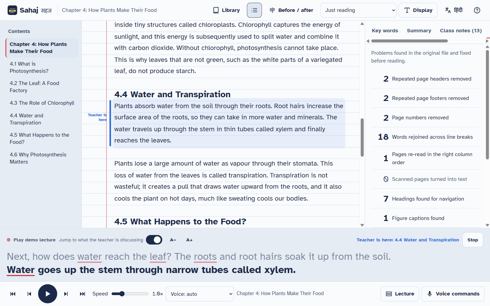

# Sahaj (सहज): one study document, adapted to every sense

Sahaj is an offline, bilingual (English + Hindi) study reader for students with visual, hearing, reading or attention difficulties. It turns a teacher's PDF, Word file, photo of a page or pasted notes into clean, structured text. Students can then **listen** to it, **read** it comfortably, and **follow a live lecture** through it.

It needs no account, no upload and no API key. Files and notes never leave the device, and the app works without internet once loaded.



## The problem with existing tools

| Pain point | What students get today | What Sahaj does |
| --- | --- | --- |
| **Deaf / hard-of-hearing students in class** | Live captions (Live Transcribe, Otter) in a separate app. The student still has to work out *where in the textbook* the teacher is. | **Lecture Sync** matches every caption to the open document in real time. The paragraph being discussed is highlighted and scrolled into view. Key terms in captions open their definition. The lecture is saved as notes **filed under the section it matched**. |
| **Messy school PDFs** | Screen readers and TTS read out "Page 3", running headers and "photo- synthesis". Two-column pages come out interleaved. | The **Clean-Read pipeline** rebuilds reading order (column detection), strips repeated headers/footers and page numbers, rejoins hyphenated words, detects headings, lists and figure captions, and OCRs scanned pages. A **Before / After** view shows exactly what was fixed. |
| **Tools work in silos** | One app for TTS, another for fonts, another for captions. | **Learning profiles** (dyslexia, low vision, blind, deaf/HoH, ADHD) change display, speech and layout in one click. Everything adapts the *same* document. |
| **Bilingual classrooms** | Mostly English-only. | English and Hindi read-aloud, captions, voice commands and interface. Hindi definitions are mined from Hindi text, there is an English→Hindi key-word glossary, and on-device paragraph translation is offered where Chrome supports it. |
| **Privacy and connectivity** | Cloud uploads and subscriptions. | 100% in-browser. An installable PWA precaches the app, fonts and OCR engine. |

## Features

**Assistive outputs**
- **Read aloud with word-by-word highlighting** (a yellow "highlighter" that follows each word). Sentence and section navigation, 0.5–2.5× speed, Indian English and Hindi voices, and click any word to start there. When a voice gives no word timing (Chrome's online voices), the highlight follows a syllable-based estimate.
- **Lecture Sync captions** (Web Speech API, `en-IN` / `hi-IN`) matched to the document with TF-IDF and forward-biased tracking. Includes large adjustable captions, linked key terms, timestamped notes and Markdown export. The **demo lecture** mode replays a scripted lecture so a demo never depends on Wi-Fi or a noisy room.
- **Voice commands** in English and Hindi, push-to-talk (`V`). Examples: "read / पढ़ो", "slower / धीरे", "next section / अगला भाग", "go to stomata", "what does chlorophyll mean / क्लोरोफिल का मतलब", "bigger text", "dark mode". Every action is confirmed through an ARIA live region, and spoken aloud in the low-vision and blind profiles.

**Adjustable reading**
- Fonts: Atkinson Hyperlegible, Lexend, OpenDyslexic, Georgia. Size, line, letter and word spacing, and line length are all adjustable.
- Themes: paper, sepia, night, high contrast (yellow on black), plus Irlen-style colour overlays.
- Reading ruler, bold word starts, syllable splitting (pho·to·syn·the·sis) and focus mode.
- **Difficulty marks** in the notebook margin: a per-paragraph reading grade.
- **Plain-language mode**: splits long sentences and swaps complex words (utilize → use). Changed words are underlined and show the original on hover. In the sample chapter, paragraph grade drops from 9 to 7.

**Study tools**
- **Key words**: definitions mined from the document's own sentences ("…is called transpiration", "X is a green pigment", "…को प्रकाश संश्लेषण कहते हैं"), with Hindi equivalents.
- **Summary**: TextRank key points per section. It can be listened to, or shortened with Chrome's on-device Summarizer when available.
- **What Sahaj fixed**: counts of every repair, word count, listening time and reading grade.

**Input formats**: PDF (including scanned pages via OCR), Word `.docx`, `.txt` / Markdown, images (JPG/PNG/WebP via Tesseract OCR, English + Hindi), and pasted text.

## Run it

```bash
cd sahaj
npm install          # also copies the offline OCR engine into public/tesseract
npm run dev          # http://localhost:5173
# or a production build with offline support:
npm run build && npm run preview   # http://localhost:4173
```

Use **Google Chrome or Microsoft Edge** for speech recognition (captions and voice commands). Read-aloud works in every modern browser. For Hindi read-aloud, Chrome's "Google हिन्दी" voice needs internet. Offline, install a Hindi voice in Windows Settings → Time & language → Speech.

```bash
npm test             # 36 unit tests: PDF layout, cleanup, NLP, lecture matching, commands
npm run test:e2e     # 28 browser tests in installed Chrome (needs `npm run build` first)
npm run test:all     # unit tests + type-check + build + browser tests
npm run sample       # regenerate the sample PDF and demo lecture script
```

The browser tests drive the real app end to end:
- opening every file type, including offline OCR of a photo
- the Before / After view
- read-aloud highlighting, both with and without word-timing events from the voice
- every display control and profile, and the keyboard shortcuts
- glossary and summary
- the demo lecture, plus live captions and voice commands through a simulated microphone
- the library, offline mode and the phone layout
- an axe-core accessibility audit of every screen and theme

## How it works

```
File ──► pdf.js text runs (x, y, size) ──► column gutter detection ──► reading-order lines
     ──► header/footer/page-number removal (repeats across pages, margin zones)
     ──► paragraph rebuilding (line gaps, indents, hyphen repair, cross-column flow)
     ──► heading levels (font-size ranks / numbering), lists, figure captions
     ──► blocks + sentences ──► Reader (word spans) ──► TTS / captions / glossary / summary
```

- `src/lib/structure/`: the Clean-Read pipeline (`pdfLayout.ts`, `build.ts`, `segment.ts`).
- `src/lib/nlp/`: readability, syllables, TF-IDF, lecture matcher, glossary mining, TextRank, plain language.
- `src/lib/speech/`: TTS with boundary fallback, speech recognition wrapper, bilingual command grammar.
- `src/lib/chromeai.ts`: optional Chrome on-device Translator and Summarizer (progressive enhancement only).
- `src/components/`: the React UI. All state lives in Zustand; documents and notes are kept in IndexedDB.

## Accessibility of the app itself

Built to WCAG 2.2 AA:
- semantic landmarks and real headings, a skip link and visible focus
- full keyboard control (press `?` for shortcuts) and focus-trapped dialogs
- ARIA live regions for captions and status
- 44px targets and `prefers-reduced-motion` support

axe-core reports **zero violations** on the reader in all four themes and on the Before / After view.

## Tech

Vite, React 18, TypeScript, Zustand, pdf.js, mammoth, Tesseract.js, idb-keyval, vite-plugin-pwa, Vitest. No backend.
